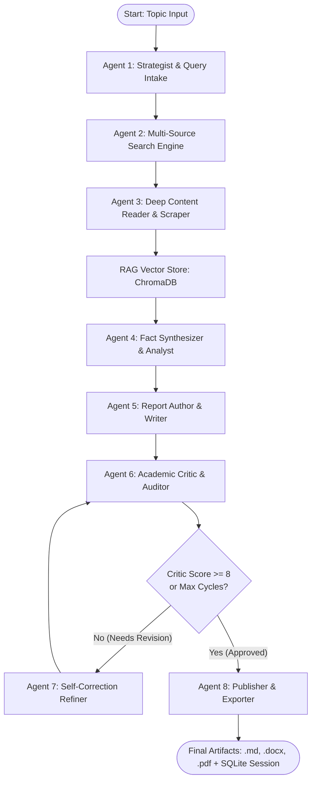

# 🧠 Research AI (Quest) — Complete Project Context & Architecture

> **Document Version:** 1.0  
> **Target System:** Research AI / Quest  
> **Last Updated:** October 2026  
> **Primary Technology Stack:** LangGraph, LangChain, FastAPI, ChromaDB, SQLite, Vanilla HTML5/CSS3/ES6

---

## Table of Contents

1. [Executive Summary](#1-executive-summary)
2. [High-Level System Architecture](#2-high-level-system-architecture)
3. [The 8-Agent Autonomous Pipeline](#3-the-8-agent-autonomous-pipeline)
4. [Backend Architecture & API Specifications](#4-backend-architecture--api-specifications)
5. [Frontend Architecture & User Interface](#5-frontend-architecture--user-interface)
6. [Data Storage & Persistence Layer](#6-data-storage--persistence-layer)
7. [LLM Provider Fallback Strategy](#7-llm-provider-fallback-strategy)
8. [Configuration & Environment Variables](#8-configuration--environment-variables)
9. [Complete Codebase File Directory](#9-complete-codebase-file-directory)
10. [Setup, Execution & Testing Guide](#10-setup-execution--testing-guide)

---

## 1. Executive Summary

**Research AI (Quest)** is a fully autonomous, multi-agent AI research orchestration platform. Built on top of **LangGraph** and **LangChain**, it accepts a natural-language research question or topic and coordinates a team of eight specialized AI agents to execute a complete, end-to-end research workflow without human intervention.

### Core Value Proposition
- **Full Automation:** Replaces hours of manual web searching, academic paper reading, fact cross-checking, and report drafting with a structured 3–8 minute multi-agent run.
- **Academic Rigor:** Incorporates an autonomous **Critic ↔ Refiner self-correction loop** that audits drafts against evidence depth, factual grounding, and citation completeness until a target score (default: ≥ 8/10) is achieved.
- **Multi-Source Evidence Gathering:** Concurrently queries general web search (Tavily, DuckDuckGo), academic preprints (arXiv), encyclopedic references (Wikipedia), news feeds (NewsAPI), and ML literature (HuggingFace Papers).
- **RAG Integration:** Indexes scraped content dynamically into a **ChromaDB vector store** using local embeddings (`sentence-transformers/all-MiniLM-L6-v2`) to allow semantic retrieval during analytical synthesis.
- **Live Real-Time Streaming:** Streams agent thought processes, phase changes, and logs directly to the browser via Server-Sent Events (SSE).
- **Multi-Format Publication:** Automatically exports verified reports with frontmatter into Markdown (`.md`), Microsoft Word (`.docx`), and Adobe PDF (`.pdf`).

---

## 2. High-Level System Architecture

```
┌────────────────────────────────────────────────────────────────────────┐
│                        CLIENT BROWSER (PORT 8123)                      │
│                                                                        │
│   index.html          new.html          report.html      history.html  │
│  (Landing/Hero)   (Desk/SSE Feed)     (Viewer/Studio)   (Session Log)  │
└───────┬───────────────────┬───────────────────┬───────────────┬────────┘
        │                   │ POST /research    │ GET /reports/ │ GET /sessions
        │                   │ (SSE EventStream) │ (.md/.docx)   │
        ▼                   ▼                   ▼               ▼
┌────────────────────────────────────────────────────────────────────────┐
│                      FASTAPI REST BACKEND (PORT 8000)                  │
│                                                                        │
│   server.py               pipeline.py              session_manager.py  │
│   ├── /research (SSE)     └── MultiAgentOrchestrator  └── SQLite DB    │
│   ├── /chat (LLM Fallback)                                             │
│   ├── /sessions                                                        │
│   └── /reports (Static Mount)                                          │
└───────────────────────────────────┬────────────────────────────────────┘
                                    │ Coordinates
                                    ▼
┌────────────────────────────────────────────────────────────────────────┐
│                 LANGGRAPH 8-AGENT STATE MACHINE                        │
│                                                                        │
│  [Agent 1: Strategist]  ──►  [Agent 2: Search Engine]                  │
│                                     │                                  │
│  [Agent 4: Analyst]     ◄──  [Agent 3: Deep Reader]                    │
│         │                           │ (Indexes into ChromaDB)          │
│         ▼                           ▼                                  │
│  [Agent 5: Writer]      ──►  [Agent 6: Academic Critic]                │
│                                     │                                  │
│                                     ▼ (Score < 8)                      │
│  [Agent 8: Exporter]    ◄──  [Agent 7: Refiner Loop]                   │
│         │                    (Loops back to Critic until score ≥ 8)    │
│         ▼                                                              │
│  .md / .docx / .pdf Reports + Live HTTP Citation Validation            │
└───────────────────────────────────┬────────────────────────────────────┘
                                    │
         ┌──────────────────────────┼──────────────────────────┐
         ▼                          ▼                          ▼
  EXTERNAL SEARCH APIs        LLM PROVIDERS (FALLBACK)   VECTOR STORAGE
  ├── Tavily Search           ├── Google Gemini (Primary)└── ChromaDB
  ├── arXiv Academic API      ├── Groq (Fast Fallback)       (Local / Cloud)
  ├── Wikipedia API           ├── Mistral AI
  └── DuckDuckGo / HF         └── HuggingFace Inference
```

---

## 3. The 8-Agent Autonomous Pipeline

The state machine is implemented in `backend/orchestrator.py` through LangGraph's `StateGraph`. The state flowing between nodes is defined by `ResearchState`.

### Pipeline Progression



### Agent Specification Matrix

| # | Agent Name | Primary Module | Core Functionality | Input / Output |
|---|---|---|---|---|
| **1** | **Strategist** | `backend/query_intake.py` | Validates query clarity, detects ambiguous requests, classifies scope, and formulates 3–5 targeted sub-queries with source hints. | **Input:** User query string.<br>**Output:** `ResearchRequest` (sub-queries, suggested sources). |
| **2** | **Search Engine** | `backend/search_sources.py` | Dispatches all sub-queries concurrently across Tavily, arXiv, Wikipedia, DuckDuckGo, NewsAPI, and Hugging Face. Normalizes results and deduplicates candidate URLs. | **Input:** Sub-queries list.<br>**Output:** Deduplicated list of `SearchResult` objects. |
| **3** | **Deep Reader** | `backend/agent.py` / `tools.py` | Uses BeautifulSoup to scrape full-page raw text, tables, quotes, and statistics from the top authoritative candidate URLs. | **Input:** Candidate URLs.<br>**Output:** Consolidated primary scraped text corpus. |
| **4** | **Analyst & Synthesizer** | `backend/knowledge_base.py` / `backend/agent.py` | Indexes raw text into ChromaDB, queries semantic vector chunks via RAG, extracts key facts, and maps consensus vs. controversies. | **Input:** Primary text & RAG chunks.<br>**Output:** Structured analytical briefing. |
| **5** | **Report Writer** | `backend/agent.py` | Drafts a comprehensive publication-grade report with Executive Summary, Deep Analysis sections, Implications, and Full Citations. | **Input:** Analyst briefing + source metadata.<br>**Output:** Full Markdown research paper draft. |
| **6** | **Academic Critic** | `backend/agent.py` | Rigorously evaluates the report on a 1–10 scale across factual grounding, evidence depth, citation integrity, and structural clarity. | **Input:** Markdown draft.<br>**Output:** `CriticEvaluation` schema (score, strengths, weaknesses, revisions). |
| **7** | **Refiner (Self-Correction)** | `backend/agent.py` | Intercepts Critic feedback when score < 8 (up to max cycles, default: 2). Patches missing evidence, rewrites weak prose, and feeds back to Critic. | **Input:** Draft + Critic actionable feedback.<br>**Output:** Upgraded report draft. |
| **8** | **Publisher & Exporter** | `backend/report_exporter.py` / `backend/citation_validator.py` | Validates all URLs via live HTTP HEAD/GET pings, prepends YAML metadata frontmatter, converts to `.docx` and `.pdf`, and logs session. | **Input:** Approved report + metadata.<br>**Output:** `.md`, `.docx`, `.pdf` files in `backend/reports/`. |

---

## 4. Backend Architecture & API Specifications

The backend is built using **FastAPI** (`backend/server.py`) and executed with **Uvicorn**.

### REST & Streaming Endpoints

| Method | Endpoint | Description | Request / Response Format |
|---|---|---|---|
| `POST` | `/research` | Launches the multi-agent pipeline and streams live status via Server-Sent Events. | **Body:** `{"topic": str, "provider": str, "max_revisions": int, "approval_threshold": int}`<br>**Response:** `text/event-stream` |
| `POST` | `/chat` | Single-turn assistant endpoint utilizing the multi-LLM fallback chain. | **Body:** `{"message": str}`<br>**Response:** `{"reply": str, "provider": str}` |
| `GET` | `/sessions` | Returns all recorded research runs from SQLite. | **Response:** `{"sessions": [...], "count": int}` |
| `GET` | `/reports/{file}` | Serves static report artifacts (`.md`, `.docx`, `.pdf`). | **Response:** File stream |
| `GET` | `/providers` | Lists supported LLM providers and the current default. | **Response:** `{"providers": [...], "default": str}` |
| `GET` | `/health` | Server liveness check. | **Response:** `{"status": "ok", "version": "1.0.0"}` |

### Server-Sent Events (SSE) Protocol
Clients listening to `/research` receive real-time JSON packets:
- `event: progress` — General log lines, search stats, and token status.
- `event: agent_start` — Dispatched when a new agent phase activates (`agent: "Strategist"`, `"Search"`, etc.).
- `event: complete` — Emitted when the pipeline finishes successfully. Contains `saved_report_path`, `critic_score`, and `sources_analyzed`.
- `event: error` — Emitted if an unrecoverable failure occurs, including stack trace details.

---

## 5. Frontend Architecture & User Interface

The frontend is located in `frontend/` and served over HTTP (default: `http://127.0.0.1:8123`). It is constructed with pure HTML5, vanilla CSS3 (dark-luxury design language, HSL color tokens, typography from Google Fonts), and modern JavaScript.

### Key Pages
- **`index.html` (Landing & Showcase):** Features a high-conversion hero, live interactive demo previews, capability breakdowns, and client-side modal login.
- **`new.html` (Research Desk):** The operational control center. Includes:
  - Natural-language topic input with voice-dictation support (Web Speech API).
  - Search depth and source selector chips (arXiv, Tavily, Wikipedia, DDG).
  - Provider selector dropdown (Gemini, Groq, Mistral, HuggingFace).
  - Real-time terminal log viewer and step-by-step progress tracker driven by the `/research` SSE stream.
- **`report.html` (Document Reader & AI Studio):**
  - Renders Markdown dynamically with full typography, table formatting, and code blocks.
  - Interactive Table of Contents (TOC) with scroll-spy navigation.
  - **Live Citation Inspector:** Displays source domains, verification status, and external links.
  - **Audio Briefing:** Real-time speech synthesis of the Executive Summary using the browser's Web Speech API.
  - **Studio Generation Suite:** Client-side generation of slide outlines, flashcards, quizzes, comparison tables, and mindmaps directly from the loaded report content.
  - Download buttons for `.md`, `.docx`, and `.pdf`.
- **`history.html` (Session Explorer):** Queries `/sessions` from the backend SQLite database. Features client-side search, status chips, score filters, sorting, and pagination.
- **`dashboard.html` (Analytics Hub):** Aggregates research metrics: total runs, average quality scores, hours saved, provider distributions, and weekly research velocity charts.

---

## 6. Data Storage & Persistence Layer

The system separates concerns across three persistent storage mechanisms:

```
┌────────────────────────────────────────────────────────────────────────┐
│                         PERSISTENCE ARCHITECTURE                       │
├──────────────────────┬─────────────────────────┬───────────────────────┤
│ ChromaDB Vector DB   │ SQLite Session DB       │ File Storage          │
│ (`backend/chroma_db`)│ (`backend/sessions.db`) │ (`backend/reports/`)  │
├──────────────────────┼─────────────────────────┼───────────────────────┤
│ • Stores embeddings  │ • Tracks session ID     │ • Stores permanent    │
│   of scraped web     │ • Stores topic string   │   Markdown (.md)      │
│   pages & snippets   │ • Stores critic score   │ • Stores Word (.docx) │
│ • Embedding model:   │ • Revision count        │ • Stores PDF (.pdf)   │
│   all-MiniLM-L6-v2   │ • Total run duration    │ • Served statically   │
│ • Powers Agent 4 RAG │ • Citation pass rate    │   via FastAPI mount   │
└──────────────────────┴─────────────────────────┴───────────────────────┘
```

---

## 7. LLM Provider Fallback Strategy

To ensure zero downtime against API rate limits (HTTP 429), quota exhaustion, or service outages, Research AI implements an automatic failover chain across multiple providers:

```
                  Incoming Request (/research or /chat)
                                   │
                                   ▼
        ┌──────────────────────────────────────────────────────┐
        │  Tier 1: Google Gemini (PRIMARY)                     │
        │  Model: gemini-3.8-flash / gemini-2.5-flash          │
        │  Context: 1M+ tokens, high analytical reasoning      │
        └──────────────────────────┬───────────────────────────┘
                                   │ On 429 / Quota / Auth Error
                                   ▼
        ┌──────────────────────────────────────────────────────┐
        │  Tier 2: Groq Cloud (FAST FALLBACK)                  │
        │  Model: openai/gpt-oss-120b or llama-3.3-70b         │
        │  Speed: Ultra-low latency inference                  │
        └──────────────────────────┬───────────────────────────┘
                                   │ On Failure
                                   ▼
        ┌──────────────────────────────────────────────────────┐
        │  Tier 3: Mistral AI (SECONDARY FALLBACK)             │
        │  Model: mistral-small-latest                         │
        │  Hosting: EU / GDPR-compliant                        │
        └──────────────────────────┬───────────────────────────┘
                                   │ On Failure
                                   ▼
        ┌──────────────────────────────────────────────────────┐
        │  Tier 4: Hugging Face Inference API (LAST RESORT)    │
        │  Model: Mistral-7B-Instruct / Zephyr-7B              │
        │  Free serverless inference endpoints                 │
        └──────────────────────────┬───────────────────────────┘
                                   │ If All Fail
                                   ▼
                       HTTP 503 Service Unavailable
                    (Returns per-provider error logs)
```

---

## 8. Configuration & Environment Variables

All sensitive API keys and operational settings are controlled via `.env` in the project root:

| Variable | Required? | Default | Description |
|---|---|---|---|
| `GEMINI_API_KEY` | **Recommended** | — | Google AI Studio key for primary Gemini models. |
| `GEMINI_MODEL` | Optional | `gemini-3.8-flash` | Gemini model variant. |
| `TAVILY_API_KEY` | **Recommended** | — | Tavily Search API key for deep web research. |
| `GROQ_API_KEY` | Optional | — | Groq API key for high-speed fallback inference. |
| `GROQ_MODEL` | Optional | `openai/gpt-oss-120b` | Groq model identifier. |
| `MISTRAL_API_KEY` | Optional | — | Mistral AI API key. |
| `MISTRAL_MODEL` | Optional | `mistral-small-latest` | Mistral model identifier. |
| `HF_TOKEN` | Optional | — | HuggingFace user token for free model inference and papers. |
| `HF_MODEL` | Optional | `mistral` | Short name (`mistral`, `zephyr`, `phi3`) or HuggingFace repo ID. |
| `CHROMA_API_KEY` | Optional | — | API key if using hosted ChromaDB Cloud. |
| `CHROMA_TENANT` | Optional | — | Tenant UUID for ChromaDB Cloud. |
| `CHROMA_DATABASE` | Optional | `ResearchAI` | Database name for ChromaDB. |
| `LLM_PROVIDER` | Optional | `gemini` | Default provider when none is explicitly supplied in request. |

---

## 9. Complete Codebase File Directory

```text
Reasearch_AI/
│
├── .env                              # API keys and environment configuration
├── .gitignore                        # Git exclusion rules (.env, .venv, reports/)
├── pyproject.toml                    # Python project configuration
├── uv.lock                           # UV package manager lockfile
├── README.md                         # Quickstart documentation & usage guide
├── HLD_Research_AI_Quest.md          # Full system High-Level Design document
├── AUDIT.md                          # Quality & capability audit verification report
├── FEATURE_PROMPTS.md                # Enhancement specification prompts
├── start_quest.bat                   # Windows batch script to start backend, frontend, & Chrome
├── stop_quest.bat                    # Script to shut down running background services
│
├── backend/                          # Backend API & Multi-Agent Engine
│   ├── server.py                     # FastAPI web server with SSE streaming endpoints
│   ├── orchestrator.py               # LangGraph 8-agent state machine coordinator
│   ├── agent.py                      # Specialized reasoning chains (Analyst, Writer, Critic, Refiner)
│   ├── query_intake.py               # Agent 1: Query decomposition and scope validation
│   ├── search_sources.py             # Agent 2: Parallel async search engine (Tavily, arXiv, DDG, etc.)
│   ├── knowledge_base.py             # Agent 4 RAG: ChromaDB embedding and retrieval pipeline
│   ├── citation_validator.py         # Agent 8: Live HTTP URL checking & domain verification
│   ├── report_exporter.py            # Agent 8: Markdown to DOCX and PDF converter
│   ├── session_manager.py            # SQLite database repository for historical research runs
│   ├── hf_provider.py                # Hugging Face Inference API provider integration
│   ├── tools.py                      # Shared LangChain tools (scrape_url, web_search)
│   ├── pipeline.py                   # High-level programmatic Python entrypoint
│   ├── main.py                       # CLI interface with Rich formatting
│   ├── requirements.txt              # Backend Python dependencies
│   ├── sessions.db                   # SQLite database storing session history
│   ├── chroma_db/                    # Local persistent vector database files
│   ├── reports/                      # Generated research papers (.md, .docx, .pdf)
│   └── tests/                        # Automated Pytest suite
│       ├── conftest.py               # Shared test fixtures and mock objects
│       ├── test_agent.py             # Chain initialization and structure tests
│       ├── test_orchestrator.py      # LangGraph state machine execution tests (mocked)
│       └── test_search_sources.py    # Search provider availability and parsing tests
│
└── frontend/                         # Pure Static Web Application
    ├── index.html                    # Platform landing page & features
    ├── new.html                      # Research Desk submission form + live SSE terminal
    ├── report.html                   # Interactive Report Viewer & AI Studio generators
    ├── history.html                  # Past research session table with filters
    ├── dashboard.html                # Analytics, KPI metrics, & provider charts
    ├── login.html                    # Authentication UI page
    └── desk.html                     # Redirect shim to new.html
```

---

## 10. Setup, Execution & Testing Guide

### 1. Installation
Ensure Python 3.10+ is installed:
```bash
# Clone the repository
git clone <repo_url>
cd Reasearch_AI

# Create and activate virtual environment
python -m venv .venv
.venv\Scripts\activate   # On Windows
# source .venv/bin/activate # On Linux/macOS

# Install dependencies
pip install -r backend/requirements.txt
```

### 2. Configuration
Populate `.env` in the root directory with at least `GEMINI_API_KEY` (or `GROQ_API_KEY`) and `TAVILY_API_KEY`.

### 3. Launching the System
- **One-Click Launch (Windows):**
  Double-click `start_quest.bat` or run:
  ```cmd
  start_quest.bat
  ```
  This automatically starts the FastAPI backend on port `8000`, the static frontend on port `8123`, and launches Google Chrome.
- **Manual Launch:**
  ```bash
  # Terminal 1: Backend
  cd backend
  uvicorn server:app --host 127.0.0.1 --port 8000 --reload

  # Terminal 2: Frontend
  cd frontend
  python -m http.server 8123 --bind 127.0.0.1
  ```

### 4. Running the CLI
To run research entirely from the command line:
```bash
python backend/main.py --topic "Mechanisms of Action of GLP-1 Receptor Agonists" --provider gemini --non-interactive
```

### 5. Executing Unit Tests
Run the automated test suite:
```bash
pytest backend/tests/ -v
```
*(58 unit tests covering agent chains, search source fallbacks, and mocked graph execution).*
