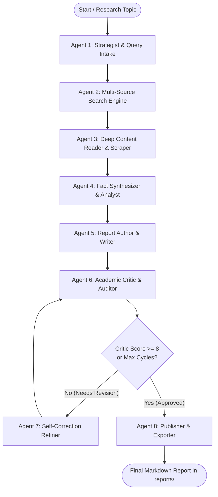

# 🧠 Research AI — Multi-Agent Research Orchestrator

An autonomous, multi-agent AI research framework powered by **LangGraph** and **LangChain**. It coordinates a team of specialized AI agents to autonomously formulate research plans, retrieve multi-source evidence, deeply scrape web pages, synthesize cross-source analytical briefings, write publication-grade reports, and perform self-correcting peer review revisions.

---

## 🏛️ Multi-Agent Architecture



### 🤖 Specialized Agents & Roles

| # | Agent / Role | Primary Capabilities & Tools | Output & Responsibilities |
|---|---|---|---|
| **1** | **Strategist (Intake)** | `QueryIntakeSystem`, Query Decomposition | Validates query clarity, breaks into 3–5 targeted sub-queries, classifies scope and recommended source types. |
| **2** | **Multi-Source Search** | `SearchOrchestrator` (Tavily, arXiv, Wikipedia, DuckDuckGo, NewsAPI, HuggingFace) | Dispatches sub-queries across academic and web engines, deduplicates URLs, and extracts top candidate pages. |
| **3** | **Deep Reader** | `scrape_url`, `BeautifulSoup`, Tool-calling Agent | Deeply inspects and scrapes full text, statistical data, and quotes from top authoritative links. |
| **4** | **Analyst / Synthesizer** | `analyst_chain`, Fact-Checker | Identifies consensus vs. controversy, cross-checks facts, and builds structured thematic briefings. |
| **5** | **Report Writer** | `writer_chain`, Structured Markdown Generator | Crafts comprehensive, publication-grade research reports with executive summaries and citations. |
| **6** | **Critic / Peer Reviewer** | `critic_chain`, Structured `CriticEvaluation` | Rigorously audits report for factual grounding, evidence depth, and citation completeness (scored 1–10). |
| **7** | **Refiner (Self-Correction)** | `refiner_chain`, Feedback Revision Loop | Autonomously incorporates the Critic's actionable feedback and fixes data gaps until approved. |
| **8** | **Publisher & Exporter** | File Exporter, YAML Frontmatter Generator | Attaches execution metadata and saves final Markdown reports to the `reports/` folder. |

---

## 🚀 Quick Start

### 1. Prerequisites & Installation

```bash
# Clone the repository
git clone <repo-url>
cd Reasearch_AI

# Install dependencies
pip install -r requirements.txt
```

### 2. Configure Environment Variables (`.env`)

```env
# Primary LLM Provider: "gemini" or "huggingface"
LLM_PROVIDER=gemini
GEMINI_API_KEY=your_gemini_api_key_here

# Search Engines
TAVILY_API_KEY=your_tavily_api_key_here
NEWS_API_KEY=your_news_api_key_here      # Optional
SERP_API_KEY=your_serp_api_key_here      # Optional

# HuggingFace (Optional free LLM & Paper search)
HF_TOKEN=your_huggingface_token_here
```

---

## 💻 CLI Usage

### Interactive Research Mode
```bash
python main.py
```

### Autonomous Direct Research
```bash
python main.py --topic "Impact of Mixture-of-Experts on LLM Inference" --non-interactive
```

### Custom Provider and Revisions
```bash
python main.py --topic "Advances in Solid-State Battery Tech" --provider gemini --max-revisions 3 --threshold 8
```

### Inspect Multi-Agent Architecture
```bash
python main.py --arch
```

---

## 📦 Programmatic Python API

```python
from pipeline import run_research_pipeline

# Run full multi-agent orchestration
state = run_research_pipeline(
    topic="Mechanisms of Action of GLP-1 Receptor Agonists",
    provider="gemini",
    max_revisions=2,
    approval_threshold=8,
    interactive=False,
    output_dir="reports"
)

print(f"Report saved to: {state['saved_report_path']}")
print(f"Final Critic Score: {state['critic_score']}/10")
```

---

## 📁 Output Artifacts

Generated reports are saved in the `reports/` directory formatted with YAML frontmatter:

```markdown
---
title: "Advances in Solid-State Battery Tech"
generated_at: "2026-09-30T22:30:00"
provider: "gemini"
critic_score: 9/10
revisions: 1
sources_analyzed: 14
---

# Comprehensive Research Report: Advances in Solid-State Battery Tech

## 1. Executive Summary
...
```
